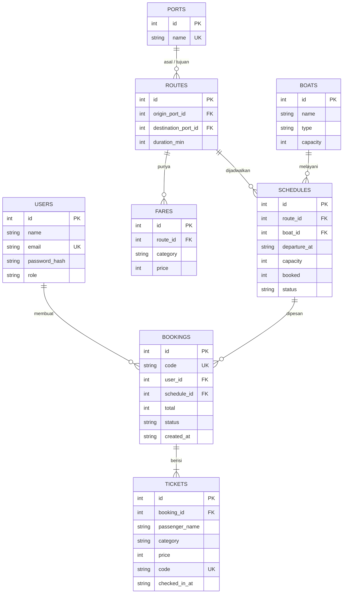

# Toba Tix

Aplikasi pemesanan tiket kapal penyeberangan dan wisata di Danau Toba. Proyek 1 matakuliah Pengembangan Aplikasi Berbasis Web (individu).

> Data pelabuhan, kapal, jadwal, dan harga di aplikasi ini adalah **data contoh**, bukan data resmi.

## Fitur

- Cari jadwal berdasarkan asal, tujuan, tanggal (dengan paginasi); sisa kursi dan tarif tampil per jadwal.
- Pemesanan dengan banyak penumpang (dewasa/anak), total harga live; harga final selalu dihitung server.
- Pembayaran simulasi dengan hitung mundur 15 menit; booking kadaluarsa otomatis batal dan kuota kembali.
- Tiket dengan kode QR, pembatalan booking (kuota dikembalikan), verifikasi tiket publik.
- Dua pintu masuk terpisah: `/masuk` (alias `/auth/login`) untuk pelanggan dan `/admin/login` untuk admin. Halaman admin menolak akun pelanggan.
- Pelanggan: profil (ubah nama, ganti password), tiket bergaya boarding pass dengan QR, cetak tiket, filter status pesanan, cek keaslian tiket publik (`/verifikasi`).
- Admin (layout sidebar): dasbor (pendapatan 7 hari, status booking, rute terlaris, keberangkatan hari ini), kelola pelabuhan, kapal, rute (+tarif), jadwal (berpaginasi), semua booking (filter, cari, batalkan), daftar pengguna, dan check-in tiket.
- Keamanan: bcrypt, JWT, validasi zod, helmet, CORS terbatas, rate limit pada `/auth`, query terparameter, otorisasi per resource.

## Tech stack

| Lapisan | Teknologi |
|---|---|
| Backend | Node.js 20+, Express, better-sqlite3 (SQLite), zod, JWT, bcryptjs, helmet, express-rate-limit |
| Frontend | Vue 3 (Vite), Vue Router, Pinia, Axios, Tailwind CSS, qrcode |
| Test | Jest + Supertest (backend), Vitest + Vue Test Utils (frontend), ESLint |
| CI/CD | Jenkins (`Jenkinsfile`): lint, test + coverage, Trivy, SonarQube, paket ZIP, deploy via API |

## ERD



## Endpoint API (prefix `/api`)

Respons sukses `{ data, message }`, respons gagal `{ message, errors? }`.

| Method | Path | Akses | Keterangan |
|---|---|---|---|
| POST | `/auth/register` | publik | Daftar (role selalu customer) |
| POST | `/auth/login` | publik | Login, mengembalikan JWT |
| GET | `/auth/me` | login | Profil sendiri |
| GET | `/ports` | publik | Daftar pelabuhan |
| GET | `/routes` | publik | Daftar rute + tarif |
| GET | `/schedules?origin=&destination=&date=&page=&limit=` | publik | Jadwal open, masa depan; `origin`/`destination` = id pelabuhan, `date` = YYYY-MM-DD (WIB) |
| GET | `/schedules/:id` | publik | Detail jadwal |
| PUT | `/auth/profile` | login | Ubah nama |
| PUT | `/auth/password` | login | Ganti password (butuh password saat ini) |
| GET | `/admin/stats` | admin | Ringkasan dasbor |
| GET | `/admin/bookings?status=&q=&page=&limit=` | admin | Semua booking, filter dan pencarian |
| GET | `/admin/users?role=&q=&page=&limit=` | admin | Daftar pengguna + jumlah booking dan total belanja |
| POST/PUT/DELETE | `/ports`, `/ports/:id` | admin | CRUD pelabuhan |
| GET/POST/PUT/DELETE | `/boats`, `/boats/:id` | admin | CRUD kapal |
| POST/PUT/DELETE | `/routes`, `/routes/:id` | admin | CRUD rute + tarif (`fares: {dewasa, anak}`) |
| GET | `/schedules/admin/list?order=asc\|desc` | admin | Semua jadwal termasuk lampau |
| POST/PUT/DELETE | `/schedules`, `/schedules/:id` | admin | CRUD jadwal |
| POST | `/bookings` | customer | `{ schedule_id, passengers: [{ name, category }] }`, maks. 10 |
| GET | `/bookings` | customer | Booking milik sendiri |
| GET | `/bookings/:code` | pemilik/admin | Detail booking + tiket |
| POST | `/bookings/:code/pay` | pemilik | Simulasi bayar |
| POST | `/bookings/:code/cancel` | pemilik/admin | Batal + kembalikan kuota |
| GET | `/tickets/:code` | publik | Verifikasi tiket (nama disamarkan) |
| POST | `/tickets/:code/checkin` | admin | Check-in (paid, hari keberangkatan, sekali) |

Kode status: 400 JSON rusak, 401 tanpa/invalid token, 403 role/kepemilikan salah, 404, 409 konflik (kursi tidak cukup, sudah check-in, dst.), 422 validasi, 500 tanpa detail internal.

## Menjalankan di komputer lokal (dari `git clone`)

Prasyarat: Node.js 20 atau lebih baru, Git.

```bash
git clone <URL-REPO-ANDA> toba-tix
cd toba-tix
```

**Backend**

```bash
cd backend
npm install
cp .env.example .env        # Windows PowerShell: Copy-Item .env.example .env
# Edit .env: isi JWT_SECRET (min. 16 karakter acak), SEED_ADMIN_PASSWORD, SEED_CUSTOMER_PASSWORD
npm run db:seed             # membuat database + data contoh
npm run dev                 # API di http://localhost:3000/api (cek /api/health)
```

**Frontend** (terminal baru, di root repo)

```bash
npm install
cp .env.example .env        # VITE_API_URL=http://localhost:3000/api
npm run dev                 # buka http://localhost:5173
```

**Akun demo:** `admin@tobatix.test` dan `customer@tobatix.test`; password adalah nilai `SEED_ADMIN_PASSWORD` dan `SEED_CUSTOMER_PASSWORD` yang Anda isi di `backend/.env`.

> **Bun (opsional):** `bun install` bisa menggantikan `npm install` di backend dan frontend. `better-sqlite3` sudah didaftarkan di `trustedDependencies` agar binary native-nya terpasang. Script tetap berjalan di Node.

## Menjalankan test dan lint

```bash
cd backend && npm test && npm run lint   # backend
npm test && npm run lint                  # frontend (root repo)
# dengan coverage (dipakai Jenkins): npm run test:ci
```

Test backend memakai SQLite in-memory (`DB_PATH=:memory:`) sehingga tidak menyentuh data asli.

**Cakupan test** (setiap file `.js` dan `.vue` di `src` punya test):

| Bagian | Lokasi | Isi |
|---|---|---|
| Backend, alur API | `backend/test/*.test.js` | auth, katalog (pelabuhan/kapal/rute/jadwal admin), booking, tiket, infrastruktur HTTP |
| Backend, unit | `backend/test/unit/*.test.js` | utils, middleware, skema zod, config/db/init/seed, `server.js`, service (booking, tiket, jadwal) |
| Frontend | `src/**/*.test.js` di samping file yang diuji | api, state (store), hook, helper, komponen, page, router, `App.vue`, `main.js` |
| Helper uji frontend | `src/test/helpers.js` (setup global di `src/test/setup.js`) | router uji, mount dengan Pinia, data contoh |

Bagian `if (require.main === module)` pada `db/init.js` dan `db/seed.js` hanya berjalan lewat CLI (`npm run db:init`/`db:seed`) sehingga tidak terhitung di coverage.

## Jenkins (CI/CD)

Pipeline ada di `Jenkinsfile` dan mengikuti pola proyek contoh `ifs24032-pabwe2026-sk-p5-vue`: build dan uji, lalu **paket ZIP** dipublikasikan ke Jenkins dan dideploy lewat API platform.

| Stage | Isi |
|---|---|
| Checkout, Validate Parameters | Ambil kode; gagal cepat bila `VITE_API_URL` masih localhost atau ID website kosong |
| Install Dependencies, Lint | `bun install` (image `oven/bun:alpine`) dan ESLint untuk backend dan frontend; test/lint/build tetap berjalan di Node 22 |
| Test Backend / Test Frontend | Jest + Supertest dan Vitest, dengan coverage; hasil tampil di **Test Result** Jenkins |
| Build Frontend | `npm run build` dengan `VITE_API_URL` dari parameter |
| Trivy Security Scan | Pindai kerentanan HIGH/CRITICAL (hasil SARIF jadi artefak) |
| SonarQube Analysis, Quality Gate | Analisis kode + coverage; build berhenti bila quality gate gagal |
| Package Application | Membuat `backend-app.zip` dan `frontend-app.zip` (tanpa `node_modules`, `.env`, database) |
| Publish Application | Arsipkan ZIP dan salin ke `userContent` Jenkins sehingga punya URL unduhan |
| Deploy Application | Request redeploy ke platform dengan URL ZIP, lalu polling sampai `SUCCESS`/`FAIL` (backend dulu, lalu frontend) |

**Menyiapkan Jenkins**

1. Plugin: Pipeline, Docker Pipeline, JUnit, Warnings Next Generation (SARIF), SonarQube Scanner, Pipeline Utility Steps (`readJSON`/`writeJSON`).
2. Konfigurasi server SonarQube bernama `SonarQube` (Manage Jenkins > System) dan webhook ke Jenkins untuk Quality Gate. Jenkins dan SonarQube berada di jaringan Docker `cicd-network`.
3. Environment variable global (Manage Jenkins > System > Global properties): `URL_REDEPLOY`, `URL_PROGRESS`, `DEPLOY_TOKEN`, `WEBSITE_ID_BACKEND`, `WEBSITE_ID_FRONTEND`.
4. Buat job **Pipeline** dengan "Pipeline script from SCM" yang menunjuk repo ini, lalu **Build with Parameters**.
5. Ambil tangkapan layar Stage View, Test Result, dan hasil Quality Gate untuk laporan.

**Urutan deploy pertama kali:** (a) jalankan build dengan `DEPLOY_FRONTEND` dimatikan untuk mendeploy backend, (b) catat URL backend online, (c) jalankan lagi dengan `VITE_API_URL=https://<url-backend>/api` untuk mendeploy frontend, (d) set `CORS_ORIGIN` backend ke URL frontend.

## Deploy online

Platform menerima ZIP dari Jenkins dan membangun aplikasinya. Pengaturan per aplikasi:

1. **Backend** (`backend-app.zip`, Node.js): build `npm install`, start `npm start`. Environment variable di platform (tidak ikut ZIP): `NODE_ENV=production`, `JWT_SECRET`, `CORS_ORIGIN` (URL frontend), `DB_PATH`, `SEED_ADMIN_PASSWORD`, `SEED_CUSTOMER_PASSWORD`. `PORT` biasanya disediakan platform.
2. **Penyimpanan SQLite.** SQLite adalah file. Jika filesystem platform sementara, data baru (akun, booking) hilang saat restart/redeploy. Aplikasi otomatis seed ulang saat start bila DB kosong sehingga data contoh dan akun demo selalu ada. Untuk data persisten, arahkan `DB_PATH` ke disk persisten bila tersedia.
3. **Frontend** (`frontend-app.zip`, statis): build `npm run build`, output `dist`. `VITE_API_URL` sudah ditanam lewat `.env.production` saat paket dibuat. Fallback SPA diatur di `vercel.json`.
4. Uji: buka `<url-backend>/api/health`, lalu buka frontend dan coba login, cari jadwal, booking.

### Alternatif: Vercel (dua project)

- **Backend:** buat project Vercel dengan Root Directory `backend`, Application Preset **Other**. Entry serverless ada di `backend/api/index.js` dan `backend/vercel.json`. Environment variable: `NODE_ENV=production`, `JWT_SECRET`, `CORS_ORIGIN` (URL frontend), `SEED_ADMIN_PASSWORD`, `SEED_CUSTOMER_PASSWORD`. DB SQLite ditulis ke `/tmp` (sementara), jadi akun dan booking baru bisa hilang saat instance baru dibuat.
- **Frontend:** project Vercel dengan Root Directory `.` (root repo), preset Vite, `VITE_API_URL=https://<backend>.vercel.app/api`. Fallback SPA ada di `vercel.json`.

## Keputusan desain

- Token JWT disimpan di `sessionStorage` (hilang saat tab ditutup, tidak ada `v-html` untuk data pengguna). Cookie httpOnly lebih tahan XSS tetapi butuh perlindungan CSRF dan konfigurasi lintas domain, jadi tidak dipakai di proyek ini.
- Waktu keberangkatan disimpan sebagai ISO UTC; tampilan dan filter tanggal memakai WIB (UTC+7).
- Pembatalan booking berstatus `paid` tidak memodelkan pengembalian dana (di luar lingkup).
- `bcryptjs` dipakai agar tidak perlu kompilasi native untuk hashing password di Jenkins.

## Struktur

Frontend berada di root repo (pola yang sama dengan `ifs24039`); folder `backend/`
masuk `.gitignore` dan dikelola sebagai repo terpisah, sehingga Jenkins, SonarQube,
dan Vercel membaca `package.json` langsung dari root.

```
.                       Frontend Vue 3 + Vite (berbasis fitur)
  src/
    features/
      admin/            api/, components/, pages/, adminConfigs.js
      auth/             api/, components/, pages/, states/
      bookings/         api/, components/, pages/, states/
      common/           components/ (AppHeader, Base*, AsyncState), pages/ (Home, NotFound), states/
      schedules/        api/, components/, pages/
      tickets/          api/, pages/
    helpers/            apiHelper (axios), errorHelper, formatHelper
    hooks/              useAsync, useCountdown, usePassengerForm
    test/               setup.js, helpers.js (setup & helper uji bersama)
    App.vue, main.js, router.js, index.css
  public/               favicon.svg
  docs/                 Draft dokumen proyek dan skrip video demo
  index.html, vite.config.js, eslint.config.js, tailwind.config.js, postcss.config.js
  vercel.json, bunfig.toml, .npmrc, .prettierignore, .env.example, .env.production
  Jenkinsfile, sonar-project.properties
backend/                Express API (repo terpisah, di-ignore git)
  src/                  app.js, server.js, config/, db/, middlewares/, utils/,
                        modules/{auth,ports,boats,routes,schedules,bookings,tickets}
  test/                 tes alur API (*.test.js) dan test/unit/
```

Tes frontend (`*.test.js`) diletakkan di samping file yang diuji.
