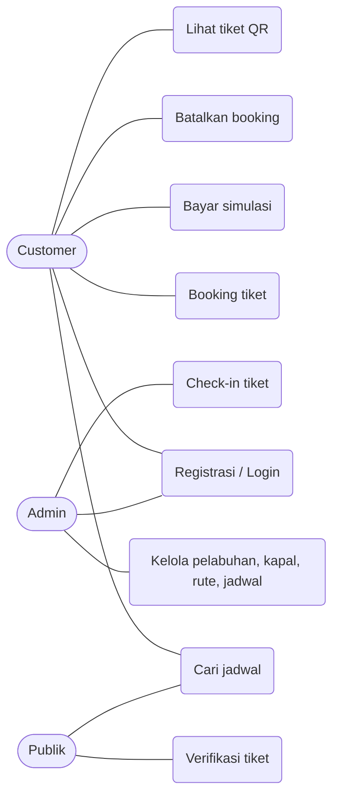

# Dokumen Proyek 1: Toba Tix

> Draft isi. Pindahkan ke template dokumen dari dosen (template belum saya terima, sesuaikan nomor bab/format). Lengkapi identitas, tautan repo, URL online, URL video.

## 1. Latar Belakang

Danau Toba adalah tujuan wisata utama di Sumatera Utara dengan penyeberangan rutin antara Ajibata dan Pulau Samosir (Tomok) serta pelayaran wisata. Pembelian tiket sering dilakukan langsung di pelabuhan sehingga calon penumpang tidak tahu ketersediaan kursi, harus mengantre, dan pengelola sulit memantau kuota serta mencocokkan penumpang. Toba Tix menyediakan pemesanan tiket daring dengan kuota yang dikelola otomatis dan tiket ber-QR untuk diverifikasi saat naik kapal.

## 2. Tujuan

1. Menyediakan layanan pencarian jadwal dan pemesanan tiket kapal secara daring.
2. Mencegah pemesanan melebihi kapasitas melalui pengelolaan kuota atomik.
3. Menyediakan alat admin untuk mengelola data dan memverifikasi tiket (check-in).
4. Menerapkan praktik pengembangan web: API REST, autentikasi, pengujian otomatis, dan CI/CD dengan Jenkins.

## 3. Ruang Lingkup

**Termasuk:** registrasi/login, pencarian jadwal, pemesanan banyak penumpang, pembayaran simulasi, pembatalan, tiket QR, verifikasi tiket, CRUD admin (pelabuhan, kapal, rute+tarif, jadwal), check-in.

**Tidak termasuk:** pembayaran sungguhan/payment gateway, pengembalian dana, notifikasi email/SMS, pemindaian QR memakai kamera (check-in lewat input kode atau scanner USB), pemilihan nomor kursi, multi-bahasa.

## 4. Kebutuhan

### 4.1 Kebutuhan Fungsional

| ID | Kebutuhan | Aktor |
|---|---|---|
| FR-01 | Registrasi dan login pengguna | Customer, Admin |
| FR-02 | Mencari jadwal berdasarkan asal, tujuan, tanggal | Semua |
| FR-03 | Melihat detail jadwal, tarif, dan sisa kursi | Semua |
| FR-04 | Membuat booking dengan 1 sampai 10 penumpang | Customer |
| FR-05 | Sistem menghitung harga dari tarif di server | Sistem |
| FR-06 | Membayar booking (simulasi) dalam 15 menit | Customer |
| FR-07 | Booking pending kadaluarsa dibatalkan otomatis dan kuota kembali | Sistem |
| FR-08 | Membatalkan booking dan mengembalikan kuota | Customer |
| FR-09 | Melihat daftar booking dan tiket QR | Customer |
| FR-10 | Verifikasi tiket publik | Semua |
| FR-11 | Mengelola pelabuhan, kapal, rute+tarif, jadwal | Admin |
| FR-12 | Check-in tiket (paid, hari keberangkatan, sekali) | Admin |

### 4.2 Kebutuhan Non-Fungsional

| ID | Kebutuhan |
|---|---|
| NFR-01 | Keamanan: password di-hash (bcrypt), JWT, validasi input, query terparameter, helmet, CORS terbatas, rate limit login |
| NFR-02 | Integritas data: transaksi database dan constraint (foreign key, CHECK, UNIQUE) |
| NFR-03 | Responsif (mobile-first) dan aksesibel (label, fokus, kontras) |
| NFR-04 | Dapat diuji: test otomatis backend dan frontend |
| NFR-05 | Dapat dijalankan ulang dari `git clone` dengan README; dapat di-deploy via Jenkins |
| NFR-06 | Error 500 tidak membocorkan detail internal |

## 5. Use Case



| Use case | Alur utama |
|---|---|
| Booking tiket | Customer memilih jadwal, mengisi penumpang, sistem memeriksa jadwal dan kuota, menghitung total, membuat booking pending dan tiket. Alternatif: kursi tidak cukup (409), jadwal sudah berangkat (409). |
| Bayar | Customer membuka booking pending, menekan bayar, status menjadi paid. Alternatif: lewat 15 menit, booking batal otomatis. |
| Check-in | Admin memasukkan kode tiket. Ditolak jika belum dibayar, bukan hari keberangkatan, atau sudah check-in. |

## 6. Rancangan Basis Data

ERD dan skema lengkap: lihat `README.md` (bagian ERD) dan `backend/src/db/schema.sql`. Aturan integritas utama: `booked BETWEEN 0 AND capacity`, rute asal tidak sama dengan tujuan, tarif unik per rute dan kategori, kode booking dan tiket unik.

## 7. Rancangan API

Tabel endpoint lengkap: lihat `README.md`. Contoh:

```http
POST /api/bookings
Authorization: Bearer <token>
{ "schedule_id": 3, "passengers": [ { "name": "Budi", "category": "dewasa" }, { "name": "Ani", "category": "anak" } ] }
```

```json
201 { "data": { "code": "TT-9F3A1C2B7D4E", "status": "pending", "total": 32000, "expires_at": "...", "tickets": [ ... ] }, "message": "Booking dibuat, selesaikan pembayaran dalam 15 menit" }
```

Kuota dikurangi dengan satu perintah atomik `UPDATE ... WHERE booked + ? <= capacity`; jika tidak ada baris berubah, API membalas 409 "Kursi tidak cukup". Seluruh proses booking berjalan dalam satu transaksi.

## 8. Arsitektur

Frontend Vue 3 (SPA) memanggil API Express lewat Axios. Backend berlapis: route, controller (HTTP), service (logika bisnis), skema zod (validasi). SQLite diakses lewat better-sqlite3 dengan query terparameter.

## 9. Pengujian

Backend (Jest + Supertest, DB in-memory): register/login, filter jadwal, booking sukses, kursi habis dan batas kapasitas, permintaan bersamaan, cancel mengembalikan kuota, kadaluarsa 15 menit, check-in dua kali ditolak, akses tanpa token/role salah. Frontend (Vitest): format, form penumpang, store auth, komponen. Pipeline Jenkins menjalankan lint, test, dan build.

## 10. Tangkapan Layar yang Perlu Diambil

- [ ] Beranda (form cari)
- [ ] Hasil jadwal (kartu jadwal) dan keadaan kosong
- [ ] Detail jadwal dengan form penumpang dan total live
- [ ] Halaman pembayaran dengan hitung mundur
- [ ] Tiket saya dan detail tiket dengan QR
- [ ] Login dan Register (termasuk pesan validasi)
- [ ] Admin: kelola jadwal, rute, kapal, pelabuhan
- [ ] Admin: check-in (sukses dan ditolak)
- [ ] Jenkins: stage view hijau, Test Result, artefak
- [ ] Output `npm test` backend dan frontend
- [ ] URL aplikasi online (halaman terbuka di browser)
- [ ] Repository GitHub

## 11. Pengumpulan

Repo GitHub: `<isi>` · URL online: `<isi>` · Video YouTube: `<isi>` · Hasil Jenkins: `<isi tangkapan layar / URL>`
